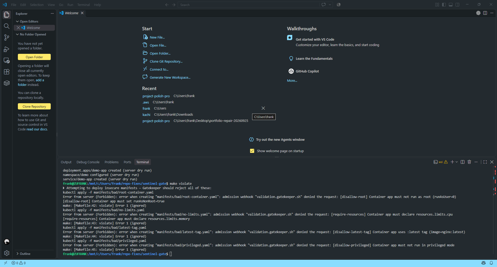

# KubeSentinel

A local Kubernetes security lab. It checks manifests and container images in CI, and uses OPA Gatekeeper admission policies to reject insecure workloads on a local kind cluster.

[](https://github.com/franklinosuji2-afk/kubesentinel/actions/workflows/ci.yml)

## What it does

| Area | What is in the repo |
|---|---|
| CI validation | `yamllint` and `kubeconform` on the manifests, plus an import check of the demo app |
| Image and config scanning | Trivy scans the built image and the repository configuration. HIGH or CRITICAL findings fail the build |
| Admission policy | Four OPA Gatekeeper constraint templates and constraints: no root containers, no privileged containers, no `latest` image tag, and resource limits required |
| GitOps | An Argo CD application that syncs the demo app from this repository |
| Observability | Prometheus (kube-prometheus-stack values) and a Grafana "Security Posture" dashboard |
| Runtime security | Falco installed through Helm with custom values |

## Architecture

```text
GitHub Actions (every push and pull request)
  Validate (yamllint, kubeconform) -> Build image -> Trivy (image + config)

Local kind cluster (make targets)
  Argo CD -> syncs demo app from Git
  Gatekeeper -> rejects root, privileged, latest-tag and no-limits workloads
  Prometheus + Grafana -> metrics and a security-posture dashboard
  Falco -> runtime alerts
```

## CI pipeline

The workflow is `.github/workflows/ci.yml` and has these jobs:

1. **Lint manifests** runs `yamllint` and `kubeconform` over `apps/`, `manifests/` and `policies/`.
2. **Test demo app** installs the dependencies and checks that the FastAPI app imports.
3. **Build image** builds the demo app container.
4. **Trivy scan** scans the image and the repository configuration for HIGH and CRITICAL findings.
5. **Validate against Gatekeeper policies** installs `conftest` and checks that the bad example manifests are present. It does not run the policies yet, since enforcement happens in the cluster at admission time.

### Security findings the pipeline caught

The Trivy image scan found three HIGH vulnerabilities in `starlette` 0.38.6, pulled in by `fastapi` 0.115.0 (CVE-2024-47874, CVE-2026-48818 and CVE-2026-54283). They were fixed by upgrading FastAPI and requiring `starlette>=1.3.1`, and the scan now passes.

### The `manifests/bad/` folder

These manifests are deliberately insecure (root user, privileged container, `latest` tag, no limits). They exist to prove that the Gatekeeper policies reject them, so the CI config scan skips this folder.

## Try it locally

You need Docker, `kind`, `kubectl` and `helm`.

```bash
make cluster     # create a kind cluster
make bootstrap   # install Argo CD, Gatekeeper, Prometheus/Grafana and Falco
make deploy      # build the demo app and deploy it through Argo CD
make scan        # Trivy scan of the image and manifests
make violate     # try to apply the insecure manifests; Gatekeeper should reject them
make destroy     # delete the cluster
```

## Repository layout

```text
apps/demo-app/            FastAPI demo app, Dockerfile and Kubernetes manifests
argocd/                   Argo CD application
cluster/                  kind config and bootstrap script
manifests/bad/            intentionally insecure example manifests
policies/gatekeeper/      constraint templates and constraints
monitoring/               Prometheus values and Grafana dashboard
security/                 Falco values and Trivy config
.github/workflows/ci.yml  CI pipeline
Makefile                  local workflow
```

## Status and limits

- This is a learning and portfolio lab that runs locally on kind. It is not a production setup.
- Verified: the CI pipeline (see the badge) builds the image, lints and validates the manifests, and runs the Trivy scans.
- Verified on a local kind cluster (17 Oct 2026): with Gatekeeper installed and the four constraint templates and constraints applied, `make violate` was rejected for all four insecure manifests (root, privileged, `latest` tag, missing limits). The demo app's own manifests passed a server-side dry run on the same cluster. The raw output is in [docs/gatekeeper-rejections.txt](docs/gatekeeper-rejections.txt).

  
- Not yet run end to end: that test installed Gatekeeper only. The Argo CD, Prometheus, Grafana and Falco parts of `make bootstrap`, and `make deploy`, are scripted but I have not run them together on a cluster yet, so expect to adjust Helm versions or values.
- Not implemented yet: running `conftest` policies in CI, SBOM generation, image signing, and alert rules for the Falco and Gatekeeper metrics.

## Author

Franklin Osuji, Cloud and DevOps engineer in Berlin.
[Portfolio](https://cfo-dev.pages.dev/) · [GitHub](https://github.com/franklinosuji2-afk) · [LinkedIn](https://linkedin.com/in/cfo-dev)

## License

See [LICENSE](LICENSE).
